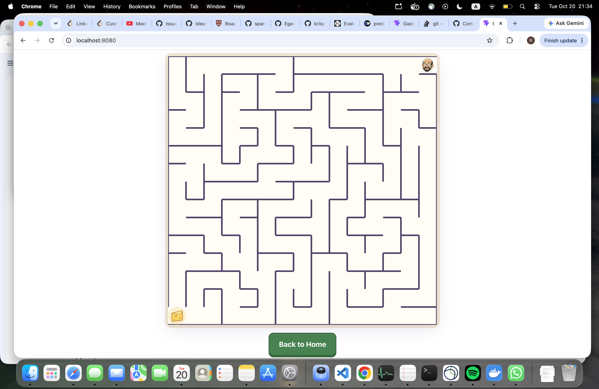
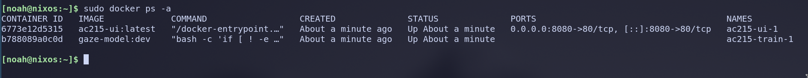

# Milestone 2 — Gaze Tracking Maze

Deliverables index. Code lives in the repository; this file maps each rubric
item to where it is.

## 1. Running instances



Containerized React UI served by nginx at `localhost:8080`.



`docker compose up` with both services running.

## 2. Containerized pipeline

| Item | Location |
|---|---|
| Model / preprocessing image | [`model/Dockerfile`](../model/Dockerfile) |
| UI image (node build → nginx) | [`ui/Dockerfile`](../ui/Dockerfile) |
| Compose | [`docker-compose.yml`](../docker-compose.yml) |
| Dependencies | [`model/pyproject.toml`](../model/pyproject.toml) (uv), [`ui/package.json`](../ui/package.json) |
| Run instructions | [root `README.md`](../README.md) |

```bash
docker compose up
```

Starts both services. The train container unpacks `MPIIFaceGaze.tar.gz` on
first run, builds the preprocessing cache, then trains.

CI builds both images on every pull request and validates the compose file.

### Data versioning

`write_manifest` emits byte-identical JSON for identical input, so
`sha256 data/MPIIFaceGaze/mpii_filtered.json` is a dataset snapshot id. The
webdataset shard index records that hash plus a sha256 per shard, so a stale
or partial cache is detectable.

This run used **37,350 of 37,667** MPIIFaceGaze samples. The 317 dropped: 243
gaze out of bounds, 72 face not detected, 2 reprojection error.

## 3. Baseline model

**Architecture.** 11.48M parameters — ImageNet-pretrained ResNet-18 over the
normalized face crop (11.31M), plus one eye tower shared across both crops
with the left flipped into the right's orientation.

**Training.** Participant-disjoint splits: train p00–p12, validate p13, test
p14. AdamW, lr 1e-4, weight decay 1e-4, batch 256, screen-fraction output.

Raw per-epoch records: [`mpiifacegaze-baseline-run.jsonl`](./mpiifacegaze-baseline-run.jsonl)

| epoch | train loss | val loss | val error | p95 | seconds |
|---|---|---|---|---|---|
| 0 | 0.02421 | 0.02122 | 0.17491 | 0.3833 | 705 |
| 1 | 0.00740 | 0.02392 | 0.18764 | 0.4026 | 852 |
| **2** | **0.00510** | **0.01397** | **0.13995** | **0.3149** | 1973 |
| 3 | 0.00385 | 0.01721 | 0.15680 | 0.3495 | 703 |
| 4 | 0.00294 | 0.01990 | 0.17174 | 0.3742 | 826 |

Best model is epoch 2. Error is Euclidean distance in screen-fraction units;
on this dataset's 286×179 mm displays that is **4.72 cm, about 4.5°** at 60 cm
viewing distance. Published MPIIFaceGaze results sit around 2.4–3.7°.

Epoch 2's 1973 s is host swapping, not the model: six DataLoader workers
exhausted memory on a 16 GB machine. Two workers restored ~700 s/epoch.

## 4. Finding and next iteration

From epoch 3 training loss keeps falling while validation loss rises. With 13
training identities an 11.5M-parameter network overfits within three passes,
so more epochs make it worse. The loop checkpoints on best validation error
and supports `--patience`.

We are data-limited, not compute-limited. Next steps, by expected payoff:

1. **GazeCapture pretraining** — ~1,450 identities against 13. Adapter is
   merged; `--init-from` loads a pretrained checkpoint with a fresh optimizer.
2. **Data augmentation** — absent from this run. Flip, crop jitter and
   photometric jitter now exist in `src/training/augment.py`.
3. **Freeze more of the backbone** — less capacity to memorize.
4. **Per-user calibration** — ridge regression over the nine-point flow. This
   fits a small linear correction on the frozen network rather than
   retraining it; published work roughly halves error with calibration.

## 5. Application

The screenshot in §1 is the running skeleton: home, nine-point calibration
capture, and the maze screen. Interface designs are in
[`proposal/main.typ`](../proposal/main.typ) under *Application Mock Design*.

Gaze-driven control is not yet wired up. Remaining: ONNX export, the
normalization reimplemented in TypeScript for browser/training parity, and
calibration persistence feeding ridge regression.
