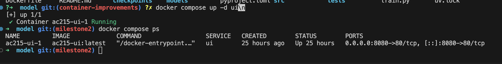

# Milestone 2 deliverables

## 1. Virtual environment / running instances


The containerized React UI served by nginx at `localhost:8080`, showing the
generated maze, the player and the goal.



`docker compose up -d ui` followed by `docker compose ps`: container
`ac215-ui-1` from image `ac215-ui:latest`, status `Up`, port `8080->80/tcp`.

## 2. End-to-end containerized pipeline

| Component | Where |
|---|---|
| Model / preprocessing image | [`model/Dockerfile`](../model/Dockerfile) |
| UI image (multi-stage node -> nginx) | [`ui/Dockerfile`](../ui/Dockerfile) |
| Compose | [`docker-compose.yml`](../docker-compose.yml) |
| Per-container dependencies (uv) | [`model/pyproject.toml`](../model/pyproject.toml), [`ui/package.json`](../ui/package.json) |
| Run instructions | [`model/README.md`](../model/README.md) |

```bash
docker compose up               # serve the web UI
docker compose run --rm train   # build the cache and train
```

`train` sits behind a compose profile because it is a job that runs to
completion while `ui` is a long-lived server, and the UI consumes nothing
training produces. CI builds both images on every PR and asserts the compose
file still resolves to exactly these two services.

### Data version tracking

`write_manifest` emits byte-identical JSON for identical input, so
`sha256 data/MPIIFaceGaze/mpii_filtered.json` is a dataset snapshot id. The
webdataset shard index records that hash plus a sha256 per shard, so a stale
or partial cache is detectable.

This run used 37,350 of 37,667 MPIIFaceGaze samples; the 317 dropped were 243
gaze-out-of-bounds, 72 face-not-detected and 2 reprojection-error.

## 3. Baseline model and experiment logs

[`experiment-log.md`](./experiment-log.md) — setup, hyperparameters, dataset
version, the per-epoch table and the next iterations.

[`mpiifacegaze-baseline-run.jsonl`](./mpiifacegaze-baseline-run.jsonl) — raw
per-epoch records.

Headline: **0.13995 screen fraction, about 4.5 degrees**, participant-disjoint
(train p00-p12, validate p13, test p14). Training loss keeps falling while
validation loss rises from epoch 3, so the model overfits 13 identities within
three passes. The next iteration is GazeCapture pretraining (~1,450
identities) rather than training longer.

## 4. Application skeleton

The UI screenshot above is the running skeleton: home, nine-point calibration
capture and the maze screen. Gaze-driven control is not yet wired up — ONNX
export, browser-side preprocessing parity and calibration persistence are
tracked as open issues.
